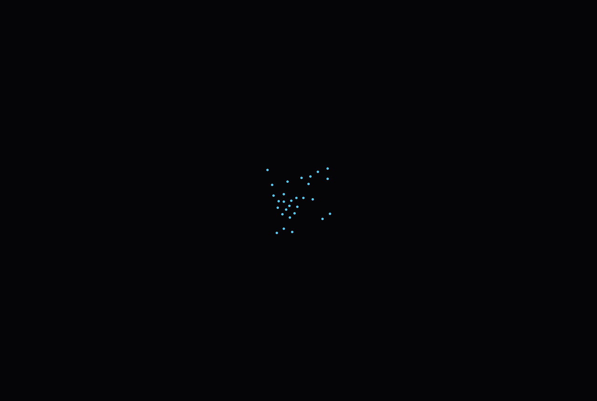

# GISCraft

Clean-room QGIS-style desktop GIS workstation and spatial processing engine in pure Rust, unifying a native map canvas, SQLite project storage, CLI, and stdio MCP server.


## What this wraps

Wraps **[QGIS](https://qgis.org)** (LTR 3.44) muscle memory—menus, shortcuts (`F5`, `F6`, `Ctrl+G`, `Ctrl+0`), Browser & Layers docks, and canvas behavior—in a clean-room pure-Rust workstation. No QGIS code ships here and none is needed to run; see [docs/WRAPPEE.md](docs/WRAPPEE.md) and [docs/plugins.md](docs/plugins.md).

## Preview


*Rendered headless by the app itself (`--smoke` BMP preview). Streets: (c) OpenStreetMap contributors.*

## What You Can Do

**How it runs:** Native `egui` workstation (`giscraft`), CLI, and pure-stdio MCP server (`giscraft-mcp`) sharing one typed command bus backed by a self-contained SQLite project database (`giscraft.db`). Zero listening ports on the native track and zero API keys required.

- **Navigate & Geocode (`Ctrl+G`):** Pan, scroll-zoom at cursor, jump to coordinates (`lat, lng`), or geocode via the 15-city offline index and keyless Photon API.
- **Harvest OpenStreetMap:** Query OSM via the fenced Overpass builder (dry-run QL or live execution) and ingest points, lines, and polygons as project layers.
- **Import & Export Layers:** Load local `.geojson` vector layers and `.csv` delimited text layers, and export any layer as RFC 7946 GeoJSON.
- **Off-Thread Tiles & Styling:** Render vectors over cached OSM XYZ basemap tiles with per-layer colors, concave fills, and labels without blocking the UI thread.
- **Attribute Table (`F6`) & Processing:** Inspect features in the Attribute Table dock (click a row to highlight on canvas) and run geodesic buffers, grids, or hub lines.
- **AI Spatial Advisor (`Ctrl+J`) & Help Center:** Press `Ctrl+J` for the built-in LLM chat dock with confirmation gates for mutating tools, `Ctrl+Shift+P` / `Ctrl+K` for the Command Palette, and drive all 10 MCP tools from Claude or Cursor.

## Install

1. Download **`giscraft-0.2.1-setup.exe`** from the [latest release](https://github.com/sandraschi/giscraft/releases/latest) (when published; pre-release builds can also be installed from a local checkout below).
2. Run the installer (if Windows SmartScreen appears on an unsigned build, choose **More info > Run anyway**).
3. Launch **GISCraft** from the Start menu.

**Only want the MCP tools in Claude Desktop?** Download `giscraft-0.2.1.mcpb` from the same release and open it with Claude Desktop (this registers the MCP server only and does **not** install the desktop app):

> Install the giscraft MCP extension: download `giscraft-0.2.1.mcpb` from https://github.com/sandraschi/giscraft/releases/latest and open it with Claude Desktop.

**From a local checkout (Windows app, CLI, and MCP bundle):**

```powershell
powershell -NoProfile -ExecutionPolicy Bypass -File scripts\install-craft.ps1
```

For manual Claude Desktop configuration, prerequisites, and source builds, see [INSTALL.md](INSTALL.md) and [docs/DEVELOPMENT.md](docs/DEVELOPMENT.md).

## Example Prompts

> "Search for Stephansplatz and show it on the map."

> "Find all pharmacies in Vienna's 1st district via Overpass and ingest them as a layer."

> "List the project layers with feature counts and export the pharmacy layer as GeoJSON."

## Documentation

| Doc | Contents |
|-----|----------|
| [Help Manual](HELP.md) | 5-step tour, shortcuts (`F5`, `F6`, `Ctrl+G`, `Ctrl+J`), spatial workflows |
| [Installation](INSTALL.md) | All install methods, prerequisites, verification prompt |
| [Onboarding](docs/ONBOARDING.md) | First run, keyless APIs, smoke test |
| [Wrapped App](docs/WRAPPEE.md) | QGIS overview, official links, community |
| [Architecture](docs/ARCHITECTURE.md) | L1/L2/L3 crates, command bus, SQLite project DB |
| [Configuration](docs/CONFIGURATION.md) | Environment variables and config options |
| [Tool Reference](docs/TOOLS.md) | All 10 MCP tools |
| [Development](docs/DEVELOPMENT.md) | Source setup, recipes, and test gates |
| [Troubleshooting](docs/TROUBLESHOOTING.md) | Common issues and fixes |
| [Docs Folder](docs/) | Glossary, parity checklists, and ecosystem notes |

## Requirements

- Windows 10/11 64-bit (primary target)
- No accounts, no API keys, no Docker (optional internet access for live Photon/Overpass/OSM tiles)

## License

MIT OR Apache-2.0. QGIS itself is GPLv2+ and not included; map tiles (c) OpenStreetMap contributors (ODbL). Adapted from the Storytold ArtCraft pattern ([storytold/artcraft](https://github.com/storytold/artcraft)).
