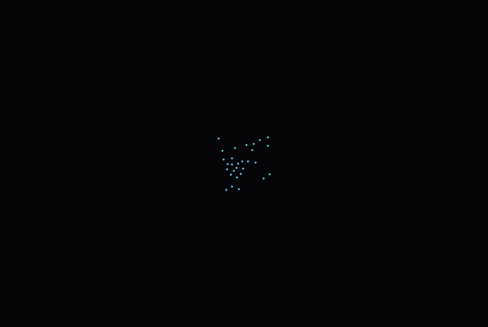

# giscraft


QGIS-class GIS in pure Rust: a clean-room 1:1 clone shell for QGIS muscle
memory, with a modern core, CLI + MCP first, and no 2005 backend cruft.

**What for:** a workbench for asking questions of the world's free map
(OpenStreetMap) and keeping the answers as your own map layers - scout
locations, audit POIs, plan walks and hikes, verify what's really there.
Type a question, get a layer, analyze it, export it - by hand or via an
AI agent (MCP). Full picture: [docs/ECOSYSTEM.md](docs/ECOSYSTEM.md).

## What this wraps

**[QGIS](https://qgis.org)** (LTR 3.44), the free and open-source desktop GIS
- the reference our menus, docks, canvas behavior and shortcuts are cloned
from, black-box. No QGIS code ships here and none is needed to run. Full
picture: [docs/WRAPPEE.md](docs/WRAPPEE.md). Our plugin answer vs
[plugins.qgis.org](https://plugins.qgis.org/): [docs/plugins.md](docs/plugins.md).

## Preview


*Rendered headless by the app itself (`--smoke` BMP preview). Streets: (c) OpenStreetMap contributors.*

## What You Can Do

**How it runs**: native egui app + CLI + MCP server over stdio, one shared
command bus. SQLite project file *is* the project (our `.qgz`). Zero ports
for the native track; no accounts, no keys (Photon/Overpass/tiles are keyless).

- Geocode places (Photon live, Vienna demo offline), search the map
- Query OpenStreetMap via fenced Overpass builder (dry-run QL or live execute)
- Ingest hits as layers (points, lines, polygons) into the project DB
- Render vectors over cached XYZ tiles: per-layer colors, concave fills, labels
- Pan/zoom-to-cursor/Fit/F5, layers dock with counts, menus + shortcuts
- Drive all of it from Claude via 9 MCP tools (same bus as the GUI)

**Track B (reserved, not built):** ports 11253/11254 are claimed for a future
sandraschi webapp for users who never learned QGIS. The native app needs none.

## Install

Pre-release: building from source is currently the only path (no installer,
no `.mcpb` yet). It takes one command chain:

```powershell
winget install Rustlang.Rustup
# + "Desktop development with C++" (MSVC linker, required on Windows)
cargo run -p giscraft --
```

Everything else - Claude Desktop wiring, env vars, verification prompt -
is in [INSTALL.md](INSTALL.md). Developers: [docs/DEVELOPMENT.md](docs/DEVELOPMENT.md).

## Example Prompts

> "Search for Stephansplatz and show it on the map"
> *(geocode.search, demo offline or live with `--live`)*

> "Find all pharmacies in Vienna's 1st district and ingest them as a layer"
> *(overpass.query key=amenity value=pharmacy + bbox, `--live --ingest`)*

> "List the project layers with feature counts"
> *(layer.list - sources, geometry, visibility, counts)*

## Documentation

| Doc | Contents |
|-----|----------|
| [Installation](INSTALL.md) | All install methods, prerequisites |
| [Onboarding](docs/ONBOARDING.md) | First run: QGIS side-by-side, keyless APIs, smoke test |
| [Wrapped app](docs/WRAPPEE.md) | QGIS: what it is, official links, community |
| [Plugin strategy](docs/plugins.md) | Why MCP tools are our plugin system |
| [Architecture](docs/ARCHITECTURE.md) | L1/L2/L3, command bus, DB-as-project, stdio framing |
| [Configuration](docs/CONFIGURATION.md) | Env vars, config options |
| [Tool Reference](docs/TOOLS.md) | All 10 MCP tools |
| [Glossary](docs/GLOSSARY.md) | Plain-language terms: bbox, Overpass, tiles, CRS, ODbL... |
| [Parity target](docs/target-app-parity.md) | QGIS scope, oracle loop |
| [UI parity](docs/ui-parity.md) | Measured checklist vs running QGIS |
| [Development](docs/DEVELOPMENT.md) | Setup, recipes, gates |
| [Troubleshooting](docs/TROUBLESHOOTING.md) | Common issues |
| [Assessment](docs/assessment.md) | Tentative self-review + cross-checks |

## Requirements

Windows 10/11 64-bit (primary), Rust stable via rustup, MSVC linker
("Desktop development with C++"). No accounts, no API keys, no Docker.

## License

MIT OR Apache-2.0. QGIS itself is GPLv2+ and not included; map tiles
(c) OpenStreetMap contributors (ODbL) - attribution shown in-app.

## Status - does today / next week / non-goals

**Does today:** 5 crates + xtask; 25 docs files; 133 test fns; justfile;
clone-shell GUI (QGIS muscle memory) + headless MCP/CLI (9 tools);
`--smoke` BMP map preview; keyless Photon/Overpass with offline demo.

**Next week:** 3 democraft recipes (geocode-layer, overpass-fenced,
render-preview); travelcraft boundary paragraph; live-service
version/rate pinning.

**Non-goals:** not full QGIS parity (shell only, on purpose); web track
reserved, not built.

## Lineage - the Storytold craft-app pattern

Storytold ArtCraft ([storytold/artcraft](https://github.com/storytold/artcraft) - "the IDE for artists") was the starting point. The 16 craft apps in the Storytold stable each ship one binary that is both the human CLI and the agent MCP server (stdio), headless-first, with `run.json` + report artifacts. That modus operandi and harness is what this repo implements; the code here is independent, the pattern is shared.
