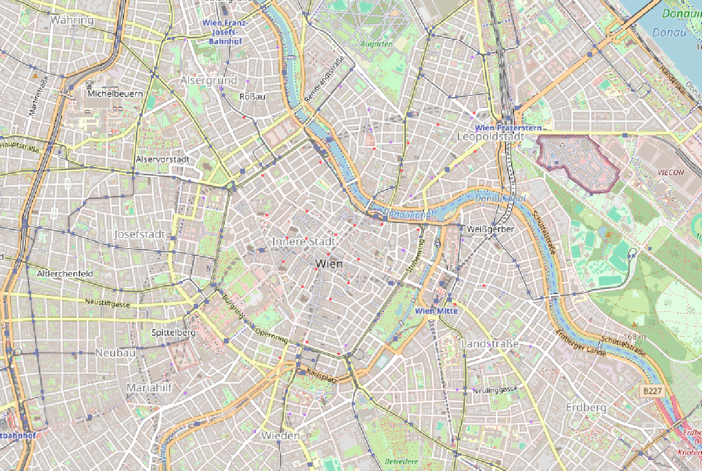

# WORKFLOWS: from question to map

How to answer a concrete question with qgiscraft, three ways.
Worked example: *"a map tile of Vienna's Innere Stadt with all bike
repair shops marked."*

## 0. Pick the right tag (5 minutes on taginfo/openstreetmap wiki)

OSM tagging is a folksonomy, not a schema. Check before you query:

- Bike *shops* (sales, most do repairs): `shop=bicycle` — 29 hits in our
  test bbox. This is the one to use.
- Pure repair workshops: `craft=bicycle_repair` — 0 hits here (mappers tag
  them as `shop=bicycle` + `service:bicycle:repair=yes` instead).
- Pharmacies (our other demo set): `amenity=pharmacy` — 29 hits, same bbox.

Rule: query the tag mappers actually use, not the one that sounds right.
Verify with a dry-run count first (see below) — a zero result usually means
a wrong tag, not an empty map.

## Path A — another app via MCP (agentic)

The calling agent needs the MCP server (`qgiscraft-mcp mcp` on stdio):

1. Dry-run the query (no network side effects, validates the tag):
   `overpass.query` with `{key: "shop", value: "bicycle", south: 48.195,
   west: 16.355, north: 48.225, east: 16.395, live: true}`.
   Check `count`. Zero? Rethink the tag (see above).
2. Ingest: same call + `"ingest": true`. Response gives `{layer,
   ingested}` — here `shop-bicycle`, 29 features.
3. Read back: `features.list` with `{"layer_id": "shop-bicycle"}`.
4. Render: `map.render` (control channel) or the web sidecar's
   `/api/preview.png?width=640&height=480` for a PNG to embed.

The caller's contract is JSON in / JSON out; the project DB
(`QGISCRAFT_DB`, default `./qgiscraft.db`) is the shared ground.

## Path B — by hand in the native app

1. Processing > Download OSM features: key `shop`, value `bicycle`,
   check "Restrict to map canvas extent" (or leave off and the same
   Innere-Stadt bbox is used as default in the dialog).
2. The layer appears, auto-fitted, over tiles. Toggle it in the Layers
   dock; click a shop for its name.
3. Vector > Export layer as GeoJSON to hand the set to anyone else.

## Path C — over plain HTTP (Track B sidecar)

```powershell
# 1. Query (dry run):
curl "http://127.0.0.1:11254/api/overpass?key=shop&value=bicycle&south=48.195&west=16.355&north=48.225&east=16.395&live=true"
# 2. Same URL + &ingest=true writes layer "shop-bicycle" (29 features).
# 3. Render a tile-ready PNG:
curl "http://127.0.0.1:11254/api/preview.png?width=640&height=480" -o wien-bikes.png
# 4. Or open the console: http://127.0.0.1:11253 (map + layers + geocode + ingest buttons)
```

Result (rendered by the app's own headless path, 29 pharmacies in red,
29 bike shops in blue, over OSM tiles):


